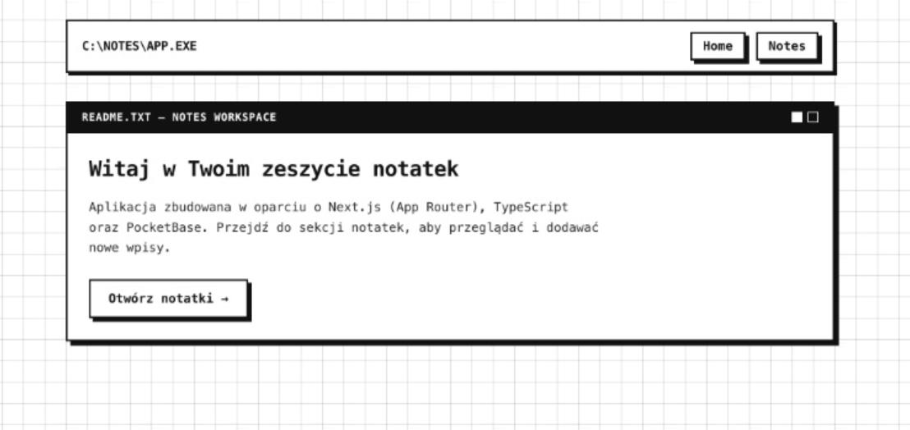

# Next.js Notes App

A clean, retro-styled notes application built with **Next.js (App Router)**, **TypeScript**, **Tailwind CSS**, and **PocketBase**.

## Tech Stack
- **Frontend:** Next.js (App Router), React, TypeScript, Tailwind CSS
- **Backend & Database:** PocketBase (SQLite + REST API)

## Features (Work in Progress)
- [x] Retro grid-paper UI layout & navigation (`Home`, `Notes`)
- [x] PocketBase database setup (`notes` collection)
- [ ] Fetching and displaying notes with Server Components
- [ ] Dynamic note details route (`/notes/[id]`)
- [ ] Creating notes with Server Actions & validation

